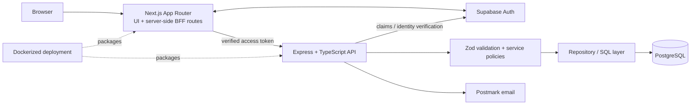
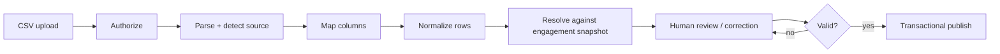

# Daubert Platform - Engineering Showcase

> **Public engineering case study.** The production source code, credentials, internal deployment configuration, and customer data are intentionally private.

Daubert is a pilot-stage legal-tech platform designed around expert-witness engagements. This repository documents selected engineering work behind the platform without publishing the commercial codebase.

My work as a **Co-Founder & Full-Stack Engineer** has focused across the application stack: authenticated full-stack workflows, backend APIs, engagement-scoped authorization, financial data integrity, PostgreSQL data modeling, CSV ingestion/review, and containerized deployment.

## What this repository demonstrates

- **Full-stack architecture:** Next.js App Router frontend with server-side API/BFF routes backed by an Express + TypeScript service layer.
- **Authentication & authorization:** Supabase Auth for identity, with matter-level authorization enforced independently from organization membership.
- **Financial correctness:** Money represented as integer cents, engagement-specific rate snapshots, and server-authoritative calculations.
- **Auditable ledger design:** Non-deletable ledger records, explicit lifecycle states, update history, and role-aware visibility.
- **CSV ingestion:** Source detection, column mapping, validation, human review, and controlled publication into the engagement ledger.
- **Defense in depth:** Validation, service-layer policy checks, query-level isolation, database constraints, and restrictive database policies using RLS.
- **Testing:** Unit coverage for financial derivations, validation, permissions, and CSV handling, plus an integration/readiness harness for authorization boundaries.

## Product workflow

1. An expert defines a reusable standing rate schedule.
2. A new engagement captures a **snapshot** of the applicable rates and financial terms.
3. Expert-side participants record work manually or import time entries from CSV.
4. Imported rows are parsed and reviewed before publication; source-provided rates never override the engagement snapshot.
5. A shared compensation ledger exposes only the records each participant is authroized to see.
6. Derived financial summaries show accrued compensation, retainer remaining, and budget utilization.

## Architecture

The browser does not need direct access to privileged application database operations. Server-side Next.js routes forward authenticated requests to Express, where business rules, authorization, transactions, and persistence are enforced.

More detail: [Architecture](docs/ARCHITECTURE.md)

## Selected engineering challenges

### Engagement-scoped authorization

Organization membership and engagement access are intentionally separate concepts. A user being part of a law firm does **not** automatically grant access to every matter associated with that firm.

The current role model distinguishes:

| Capability                 | Lead expert | Collaborator | Attorney |
| -------------------------- | :---------: | :----------: | :------: |
| View shared ledger records |      ✓      |      ✓       |    ✓     |
| View staged work           |     All     |   Own only   |    —     |
| Create expert-side work    |      ✓      |      ✓       |    —     |
| Publish staged work        |      ✓      |      —       |    —     |
| Edit eligible accrued work |      ✓      |   Own only   |    —     |
| Import / preview CSV       |      ✓      |      ✓       |    —     |

See [Authorization Model](docs/AUTHORIZATION_MODEL.md).

## Financial data integrity

Several design choices reduce historical drift and rouding errors:

- Monetary values are represented as **integer cents**.
- An engagement receives a **rate schedule snapshot** when it is created.
- Later changes to an expert's standing rates do not retrocatively change existing engagement rates.
- Imported CSV rates are treated as source metadata; the server resolves the rate actually applied from the engagement snapshot.
- Drived totals are calculated from authoritative ledger state rather than trusting client-calculated values.

See [Data Integrity](docs/DATA_INTEGRITY.md)

### Review-first CSV ingestion

See [CSV IMport Pipeline](docs/CSV_IMPORT_PIPELINE.md)

## Testing approach

The private code snapshot represented by this showcase contains **45 Node test cases across four TypeScript test files** covering financial derivations, ledger input rules, authorization policy behavior, and CSV parsing/import behavior.

A separate backend-focused readiness harness exercises important boundaries without relying on UI hiding, including:

- unauthenticated requests;
- cross-engagement isolation;
- stages-record visibility;
- direct-ID mutation attempts;
- shared financial-summary consistency
- CSV preview/publish permissions;
- "same organization but not on matter" access;
- platform-administrator separation.

This repository intentionally documents those categories rather than publishing the internal test harness.

See [Testing & Verification](docs/TESTING.md)

## Technology

**Frontend:** TypeScript, React, Next.js App Router, Tailwind CSS
**Backend:** TypeScript, Express, Zod, Node.js
**Data & identity:** PostgreSQL, Supabase Auth
**Infrastructure:** Docker, container networking, external reverse-proxy/tunnel deployment
**Integrations:** Postmark email
**Engineering:** REST APIs, transaction boundaries, row-level/query-level authorization, server-side validation

## Screenshots

Use synthetic demo data only. The recommended public screenshot set is documented in
['assets/screenshots/README.md'](assets/screenshots/README.md)

Suggested gallery:

| View                         | What it demonstrates                                       |
| ---------------------------- | ---------------------------------------------------------- |
| `01-dashboard.png`           | Role-aware workspace and recent engagements                |
| `02-create-engagement.png`   | Matter terms, financial inputs, and rate snapshot workflow |
| `03-engagement-overview.png` | Matter details plus accrued/retainer/budget summaries      |
| `04-billing-ledger.png`      | Frozen rate schedule and shared compensation ledger        |
| `05-csv-review.png`          | Review-first CSV import with valid/warning/error states    |
| `06-standing-rates.png`      | Reusable expert standing-rate management                   |
| `07-attorney-read-only.png`  | Role-aware, read-only counsel experience                   |
| `08-mobile.png`              | Responsive application shell                               |

## Sanitized implementation examples

The files under ['examples/'](examples/) are **illustrative rewrites**, not copied production source code. They demonstrate selected engineering patterns while deliberately omitting internal schemas, endpoint structure, identifiers, infrastructure details, and proprietary implementation logic.

- [`authorization-policy.ts`](examples/authorization-policy.ts)
- [`financial-calculations.ts`](examples/financial-calculations.ts)
- [`service-boundary.ts`](examples/service-boundary.ts)
- [`csv-import-pipeline.ts`](examples/csv-import-pipeline.ts)

## Selected desing decisions

See [Engineering Decisions](docs/ENGINEERING_DECISIONS.md)

- separating organization membership from matter access;
- using integer cents for money;
- snapshotting rates at engagement creation;
- routing privileged writes through the backend;
- validating at API, service, query, and database boundaries;
- making imported financial data advisory until server-authoritative review/publish.

## Source availability

Daubert is an active commercial project, so the complete source doe and deployment configuration are not public. This repository exists to show the **engineering approach, architecture, and selected implementation patterns** without exposing the private product.

For recruiting or technical discussion, I can walk through additional design decisions and implementation tradeoffs wihtout distributing the private repository.