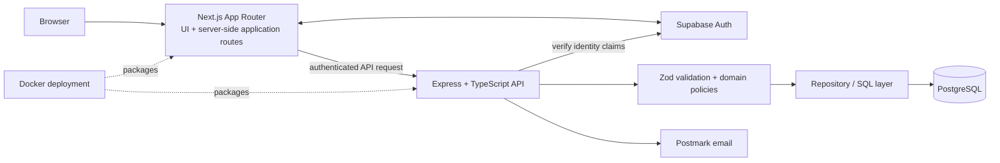
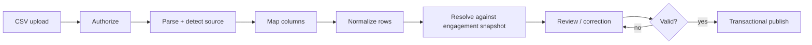
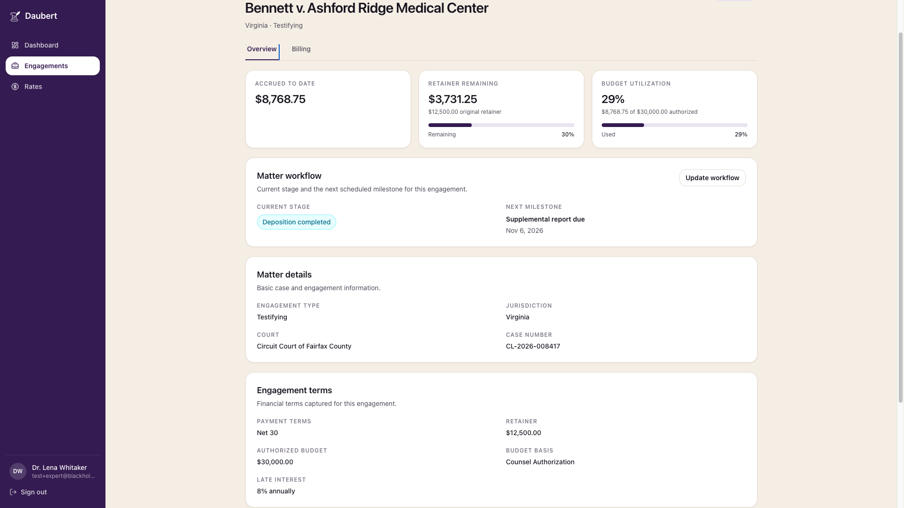
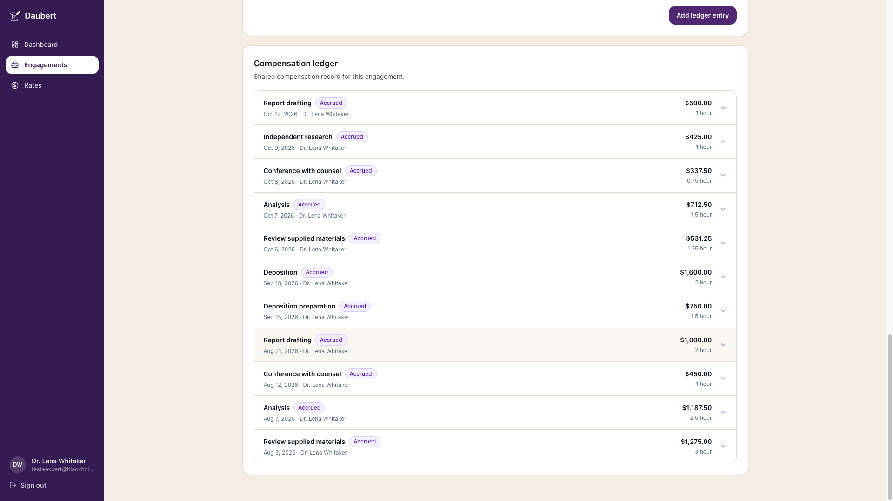
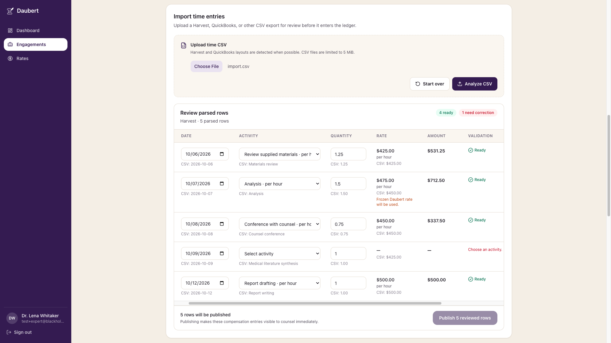

# Daubert Platform — Engineering Showcase

> **Public engineering case study.** Daubert is an active commercial project; production source code, credentials, internal deployment configuration, and non-public data are intentionally excluded from this repository.

Daubert is a pilot-stage legal-tech platform built around expert-witness engagements. This repository presents selected architecture, engineering decisions, workflows, testing strategy, and sanitized implementation examples from the private application.

My work as a **Co-Founder & Full-Stack Engineer** spans authenticated full-stack workflows, backend APIs, engagement-scoped authorization, financial data integrity, PostgreSQL data modeling, CSV ingestion and review, and containerized deployment.

## Engineering scope

- **Full-stack architecture:** Next.js App Router frontend with server-side application routes backed by an Express + TypeScript API.
- **Authentication and authorization:** Supabase Auth for identity, with engagement-level access enforced separately from organization membership.
- **Financial correctness:** Integer-cent money representation, engagement-specific rate snapshots, and server-authoritative calculations.
- **Auditable ledger workflows:** Explicit lifecycle states, update history, and role-aware visibility.
- **CSV ingestion:** Source detection, column mapping, normalization, validation, human review, and controlled publication.
- **Defense in depth:** Runtime validation, service-layer policy checks, query-level isolation, database constraints, and restrictive data-access policies.
- **Verification:** Unit tests for financial derivations, validation, authorization policy behavior, and CSV handling, plus a backend-focused readiness harness for access-control boundaries.

## Product workflow

1. An expert defines a reusable standing rate schedule.
2. A new engagement captures the applicable rates and financial terms in an **engagement-specific snapshot**.
3. Expert-side participants record work manually or import time entries from CSV.
4. Imported rows are parsed, normalized, validated, and reviewed before publication.
5. The server resolves authoritative rates and calculated amounts from the engagement snapshot.
6. A shared compensation ledger exposes records according to engagement role and lifecycle state.
7. Derived summaries report accrued compensation, retainer remaining, and authorized-budget utilization.

## System architecture

Privileged application writes are routed through the backend, where authentication, authorization, business rules, transactions, and persistence are enforced.

[Read the architecture overview →](docs/ARCHITECTURE.md)

## Engineering highlights

### Engagement-scoped authorization

Organization membership and engagement access are separate concepts. Membership in a law firm does **not** automatically grant access to every matter associated with that organization.

| Capability                            | Lead expert | Collaborator | Attorney |
| ------------------------------------- | :---------: | :----------: | :------: |
| View shared/non-staged ledger records |     Yes     |     Yes      |   Yes    |
| View staged records                   |     All     |   Own only   |    No    |
| Create expert-side ledger records     |     Yes     |     Yes      |    No    |
| Edit eligible accrued records         |     Yes     |   Own only   |    No    |
| Publish staged records                |     Yes     |      No      |    No    |
| Import / preview CSV                  |     Yes     |     Yes      |    No    |

[Read the authorization model →](docs/AUTHORIZATION_MODEL.md)

### Financial and historical integrity

Several design choices prevent historical drift and reduce monetary-calculation errors:

- Monetary values are stored and processed as **integer cents**.
- Engagements preserve an **engagement-specific rate schedule snapshot**.
- Later changes to an expert's standing rates do not silently alter existing engagement terms.
- Imported rates are treated as source metadata; authoritative applied rates are resolved by the server.
- Derived financial totals are calculated from authoritative ledger state rather than client-submitted totals.

[Read the data-integrity design →](docs/DATA_INTEGRITY.md)

### Review-first CSV ingestion

The import pipeline separates parsing, mapping, normalization, business validation, rate resolution, and publication so external data cannot bypass engagement rules.

[Read the CSV import design →](docs/CSV_IMPORT_PIPELINE.md)

## Product views

All public screenshots use synthetic demonstration data.

### Engagement workspace

The engagement workspace combines matter details with derived financial context such as accrued compensation, retainer remaining, and authorized-budget utilization.

### Compensation ledger

The billing workflow pairs the engagement's frozen rate schedule with a role-aware compensation ledger.

### CSV review workflow

Imported time entries are staged for review, validation, correction, or removal before controlled publication.

Additional product views are documented in the [Product Walkthrough](docs/PRODUCT_WALKTHROUGH.md).

## Testing and verification

The private code snapshot represented by this showcase contains **45 Node test cases across four TypeScript test files**:

| Area                         |  Tests |
| ---------------------------- | -----: |
| Financial and derived values |     24 |
| Ledger authorization policy  |     11 |
| CSV import behavior          |      5 |
| Ledger input validation      |      5 |
| **Total**                    | **45** |

A separate backend-focused readiness harness exercises boundaries including:

- unauthenticated request rejection;
- cross-engagement isolation;
- staged-record visibility;
- direct-ID mutation attempts;
- shared financial-summary consistency;
- CSV preview and publication permissions;
- same-organization-but-not-on-matter access;
- platform-administrator separation from matter participation.

The internal test harness and its environment-specific fixtures remain private.

[Read the testing strategy →](docs/TESTING.md)

## Technology

| Layer                | Technologies                                                               |
| -------------------- | -------------------------------------------------------------------------- |
| Frontend             | TypeScript, React, Next.js App Router, Tailwind CSS                        |
| Backend              | TypeScript, Node.js, Express, Zod                                          |
| Data & identity      | PostgreSQL, Supabase Auth                                                  |
| Infrastructure       | Docker, container networking, reverse-proxy/tunnel deployment              |
| Integrations         | Postmark                                                                   |
| Engineering patterns | REST APIs, transactions, query-level authorization, server-side validation |

## Sanitized implementation examples

The files in [`examples/`](examples/) are intentionally simplified rewrites of selected engineering patterns. They are **not copied production source** and omit private schemas, route structure, identifiers, infrastructure details, and proprietary implementation logic.

- [`authorization-policy.ts`](examples/authorization-policy.ts) — role, ownership, and lifecycle-aware access decisions
- [`financial-calculations.ts`](examples/financial-calculations.ts) — integer-cent financial calculations
- [`service-boundary.ts`](examples/service-boundary.ts) — validation, authorization, transactions, and server-authoritative writes
- [`csv-import-pipeline.ts`](examples/csv-import-pipeline.ts) — review candidates and snapshot-based rate resolution

## Documentation

- [Architecture](docs/ARCHITECTURE.md)
- [Authorization Model](docs/AUTHORIZATION_MODEL.md)
- [Financial & Data Integrity](docs/DATA_INTEGRITY.md)
- [CSV Import Pipeline](docs/CSV_IMPORT_PIPELINE.md)
- [Testing & Verification](docs/TESTING.md)
- [Selected Engineering Decisions](docs/ENGINEERING_DECISIONS.md)
- [Product Walkthrough](docs/PRODUCT_WALKTHROUGH.md)

## Source availability

Daubert is an active commercial project. The production repository, database migrations, credentials, deployment configuration, internal test harnesses, and complete application source are not distributed publicly.

This showcase is limited to selected architecture, engineering rationale, product views, testing strategy, and intentionally sanitized implementation examples.