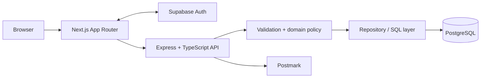
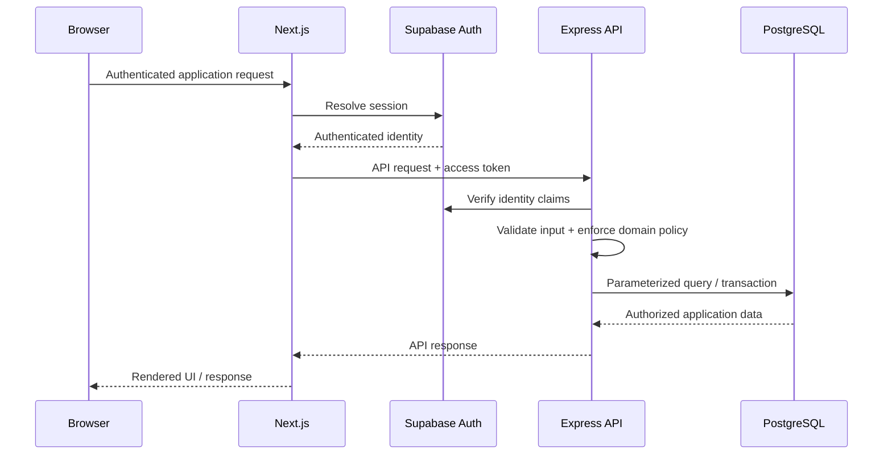
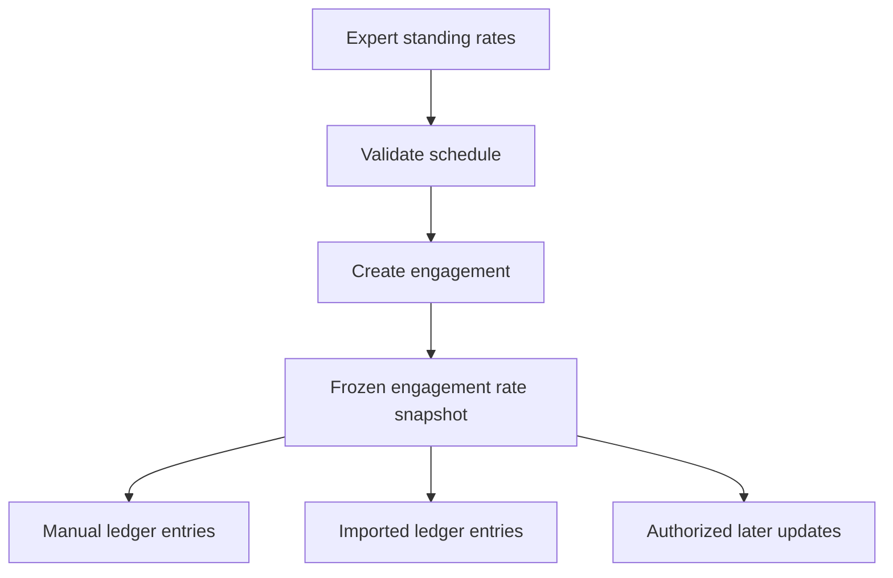

# Architecture

## Overview

Daubert uses a separated frontend, API, identity, and persistence architecture so authentication, authorization, business rules, financial calculations, and database access remain on trusted server boundaries.

## Request flow

## Frontend

The frontend uses **Next.js App Router, React, and TypeScript**.

Its responsibilities include:

- authenticated application navigation and page rendering;
- responsive forms and workflow interfaces;
- server-side session access;
- application routes that forward authenticated requests to the backend;
- interactive review workflows such as ledger-entry editing and CSV import.

The frontend is not treated as the authorization boundary. Interface visibility reflects permissions, but backend authorization remains authoritative.

## Backend

The backend is an **Express + TypeScript** service.

Its responsibilities include:

- bearer-token authentication;
- Zod-based runtime input validation;
- engagement-role and access checks;
- transaction boundaries;
- server-authoritative financial calculations;
- domain-service orchestration;
- repository and database access;
- email integration.

The private implementation separates HTTP routing, validation/domain services, and persistence concerns so each layer can be tested and evolved independently.

## Authentication

Supabase Auth provides user identity and session/token issuance.

Authentication answers:

> **Who is the caller?**

Application authorization is handled separately and answers:

> **What may this caller do on this engagement?**

This separation is important because organization membership does not automatically imply matter access.

## Persistence

PostgreSQL stores application data including:

- users and organizations;
- organization memberships;
- engagements;
- engagement participants;
- expert standing rates;
- engagement rate snapshots;
- ledger records;
- ledger update history.

Privileged business writes pass through the backend so validation, authorization, transactions, and financial invariants are enforced consistently.

## Financial architecture

The platform preserves the rates that apply to an engagement rather than resolving every future calculation against an expert's current standing rates.

Monetary values are stored and processed as integer cents, while user-facing dollar inputs are parsed at the application boundary.

## Deployment

Frontend and backend services are containerized with Docker and communicate over the deployment's internal service network. External traffic reaches the application through the deployment's proxy/tunnel layer.

Environment-specific infrastructure, secrets, hostnames, and production deployment configuration are intentionally excluded from this public showcase.