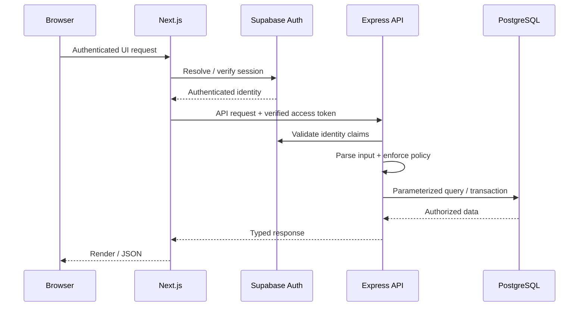

# Architecture

## Goals

The application architecture is designed to keep authentication, authorization, business rules, financial calculations, and persistence on trusted server boundaries while still supporting a modern responsive frontend.

## High-level flow



## Frontend

The frontend uses **Next.js App Router + React + TypeScript**.

Responsibilites include:

- authenticated navigation and page rendering;
- responsive forms and workflow UI;
- server-side session access;
- BFF/proxy routes that forward the authenticated user's access token to the backend;
- client-side interaction for review-heavy workflows such as ledger entry editing and CSV import.

The frontend is not treated as an authorization boundary. Hiding a button does not grant or revoke permission.

## Backend

The backend is an **Express + TypeScript** service.

Its responsibilities include:

- bearer-token authentication;
- runtime input validation;
- role and engagement access checks;
- transaction boundaries;
- server-authoritative financial calculation;
- orchestration across domain services and repositories;
- controlled database access;
- email integration.

The internal structure follows a route -> schema/service -> repository pattern so HTTP concerns, business rules, and persistence can evolve independently.

## Authentication

Supabase Auth is used for user identity and session/token issuance.

Authentication answers:

> "Who is this user?"

Application authorization is handled separately and answers:

> "What may this user do on this specific engagement?"

Keeping those questions separate is important because organization membership alone is not sufficient to access a legal matter.

## Persistence

PostgreSQL stores application data such as:

- users and organizations;
- memberships;
- engagements;
- engagement participants;
- expert standing rates;
- engagement rate snapshots;
- ledger records and update history.

Business writes are routed through the backend so application invariants and transactions are enforced in one place.

Database constraints and restrictive access policies provide additional protections against invalid or over-broad access.

## Financial architecture

The most important financial rule is that historical calculations should not drift because a standing rate changes later.

At engagement creation:

```text
expert standing rates
        ↓
validated rate schedule
        ↓
engagement-specific snapshot
        ↓
future ledger entries resolve against that snapshot
```

Money is stored and calculated as integer cents.

## Deployment

The application is containerized with Docker. Frontend and backend run as separate services on an internal network, with external traffic reaching the frontend through the deployment proxy/tunnel layer.

Production credentials and environment configuration are intentionally excluded from this showcase.