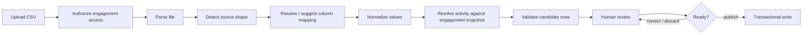

# CSV Import Pipeline

Daubert's CSV workflow is a **review-first ingestion pipeline**, not a direct bulk-insert path.

## Pipeline

## Authorization before parsing

The backend verifies engagement access before performing the more expensive parsing and normalization work.

This prevents an unauthorized request from reaching deeper import processing simply because it contains a syntactically valid file.

## Source detection and mapping

The importer can recognize supported export shapes and fall back to a generic CSV mapping path.

The workflow separates:

- source-shape detection;
- column mapping;
- parsing;
- normalization;
- business validation;
- engagement-rate resolution.

Keeping these steps separate allows source formats to evolve without coupling the compensation ledger to one vendor-specific CSV schema.

## Review candidates

Previewing an import produces review candidates rather than immediately creating authoritative ledger records.

A review candidate can carry information such as:

- normalized work date;
- normalized activity;
- quantity;
- source-provided rate;
- server-resolved engagement rate;
- calculated amount;
- warnings;
- validation errors;
- original source values needed for review.

## Server-authoritative rate resolution

A rate supplied by an imported file is not blindly copied into the authoritative applied-rate field.

Instead:

1. the imported activity is mapped to the engagement's frozen rate schedule;
2. the server resolves the applicable engagement rate;
3. the amount is derived from that rate;
4. a mismatch with the source rate can be surfaced as a review warning.

This allows external data to assist ingestion without overriding the terms captured for the engagement.

## Human review and publication

The review interface allows invalid or questionable candidates to be corrected or discarded before publication.

Publication occurs only after the candidate set satisfies the workflow's validation requirements, keeping import convenience from bypassing domain rules.