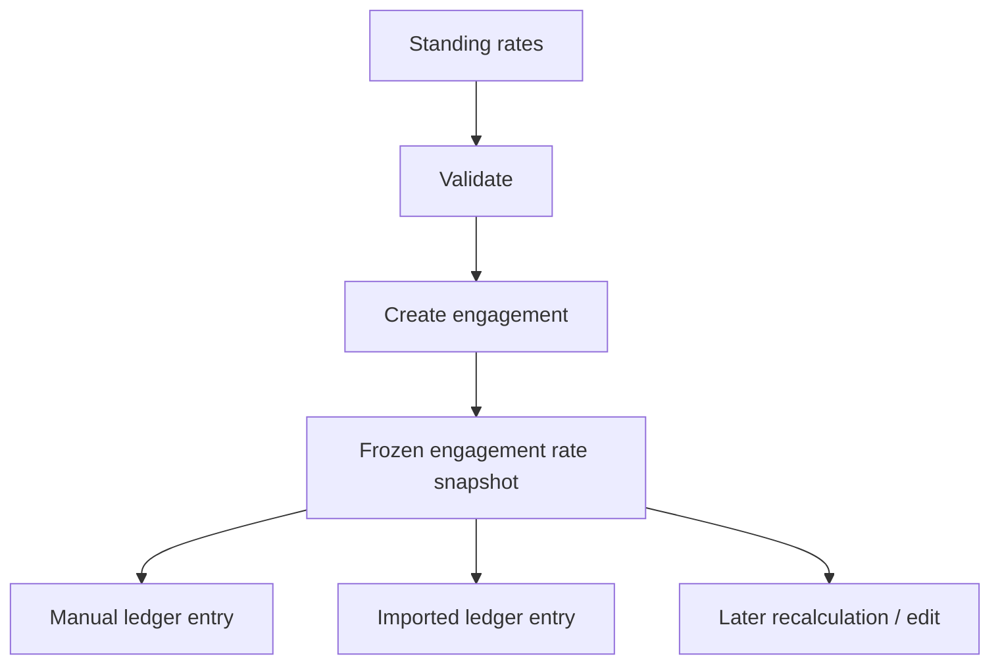

# Financial & Data Integrity

Financial workflows are designed around the idea that **stored history should remain explainable later**.

## Integer-cent money

Application money is represented as integer cents rather that floating-point dollar values.

Illustrative example:

```ts
type Cents = number & { readonly __brand: "Cents" };

function calculateAmount(quantity: number, rate: Cents): Cents {
  const value = Math.round(quantity * rate);

  if (!Number.isSafeInteger(value)) {
    throw new Error("Unsafe monetary value");
  }

  return value as Cents;
}
```

This avoids using binary floating-point values as the canonical representation of currency.

## Frozen rate schedules

Expert maintain reusable standing rates, but an engagement should preserve the rates that applied when that engagement was created.

## Frozen rate schedules

Experts maintain reusable standing rates, but an engagement should preserve the rates that applied when that engagement was created.



Changing a standing rate later affects future engagements, not the historical snapshot used by an existing matter.

## Server-authoritative calculations

Clients may submit work date, activity, quantity, and other allowed inputs, but the server is responsible for resolving:

- the applicable rate;
- the resulting monetary amount;
- the actor identity;
- allowed lifecycle state transitions.

The client cannot make a financial value authoritative simply by including it in the request.

## CSV source rates are advisory

Imported systems may contain a rate column. That value is useful for source detection and review, but it does not replace the engagement's authoritative snapshot.

If the source rate differs from the engagement rate, the workflow can warn the reviewer while still calculating from the engagement snapshot.

## Transaction boundaries

Mutations that depend on current ledger state are performed inside database transactions. Where a decision could be invalidated by a concurrent update, the row is locked before applying the transition.

Conceptually:

```text
BEGIN
  load authorized mutation context
  lock target row
  validate current state
  recompute server-authoritative values
  write update + audit/update record
COMMIT
```

## Ledger history

The ledger is designed so records are not simply deleted to erase history. Lifecycle transitions such as withdrawal preserve the record while changing whether it contributes to active accrued work.

Creation timestamps are protected, and update history is recorded separately.

This is an auditability choice rather than a claim that every field can never change.