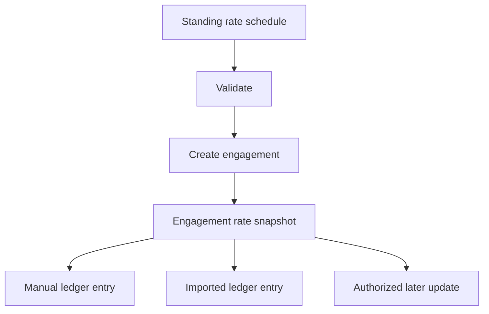

# Financial & Data Integrity

Daubert's financial workflows are designed around a simple requirement:

> **Historical financial state should remain explainable later.**

That requirement influences how money, rates, ledger transitions, and imported data are represented.

## Integer-cent money

Monetary values are stored and processed as integer cents rather than using floating-point dollar values as the canonical representation.

User-facing dollar values are parsed at the application boundary before entering the domain model.

Illustrative example:

```ts
type Cents = number & {
  readonly __brand: "Cents";
};

function calculateAmount(
  quantity: number,
  rateApplied: Cents,
): Cents {
  const amount = Math.round(
    quantity * rateApplied,
  );

  if (!Number.isSafeInteger(amount)) {
    throw new Error(
      "Calculated amount is outside the safe integer range.",
    );
  }

  return amount as Cents;
}
```

This keeps currency representation explicit and avoids treating binary floating-point dollar arithmetic as authoritative.

## Engagement-specific rate snapshots

Experts can maintain reusable standing rates, while each engagement preserves the schedule applicable to that matter.



A later change to an expert's standing rates applies to future work configuration without silently rewriting the historical rate schedule captured for an existing engagement.

## Server-authoritative calculations

Clients may submit permitted inputs such as:

- work date;
- activity;
- quantity;
- note content.

The server remains responsible for resolving:

- the applicable engagement rate;
- the calculated monetary amount;
- the authenticated actor;
- permitted lifecycle transitions.

Client-submitted financial values do not become authoritative simply because they appear in a request.

## Imported rates are advisory

External time-entry exports may include a rate column. That source rate is useful for detection and review, but it does not replace the engagement's authoritative snapshot.

When an imported source rate differs from the engagement rate, the review workflow can surface the mismatch while the server continues to calculate from the engagement snapshot.

## Transaction boundaries

Mutations that depend on current ledger state are performed within database transactions. Where a state decision could become stale during a concurrent update, the target state is loaded and protected before the mutation is applied.

Conceptually:

```text
BEGIN
  load authorized mutation context
  lock current target state
  validate lifecycle transition
  resolve authoritative rate
  recompute derived monetary value
  write mutation and update history
COMMIT
```

## Ledger lifecycle and history

Ledger entries use explicit lifecycle states including:

- `staged`
- `accrued`
- `invoiced`
- `paid`
- `withdrawn`

The normal workflow preserves records through state transitions rather than using deletion as the mechanism for reversing history. Update history is stored separately so later changes can remain attributable.

This is an auditability design: records may move through supported states while the system retains the context needed to explain prior financial activity.