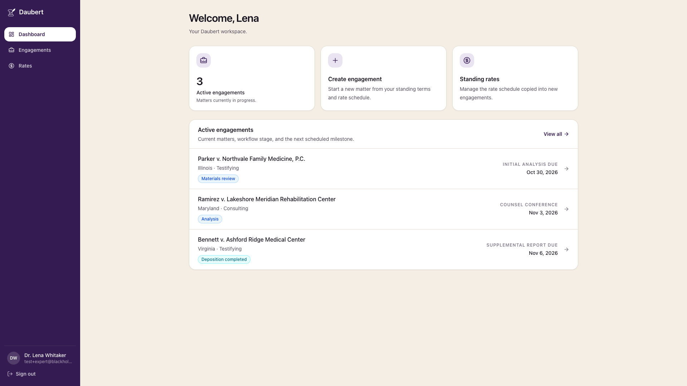
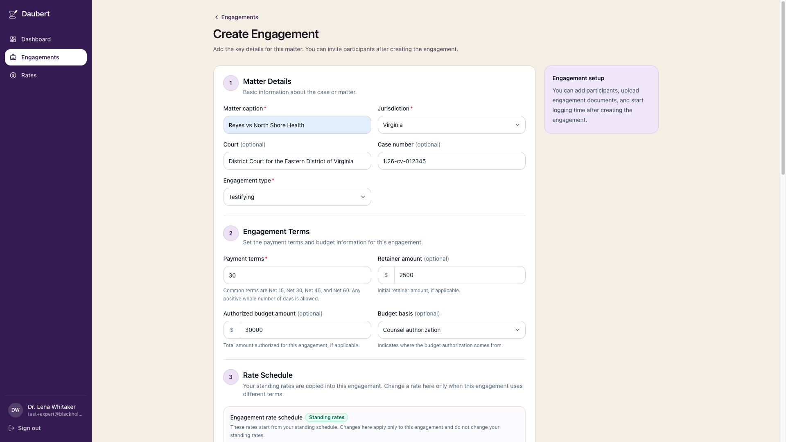
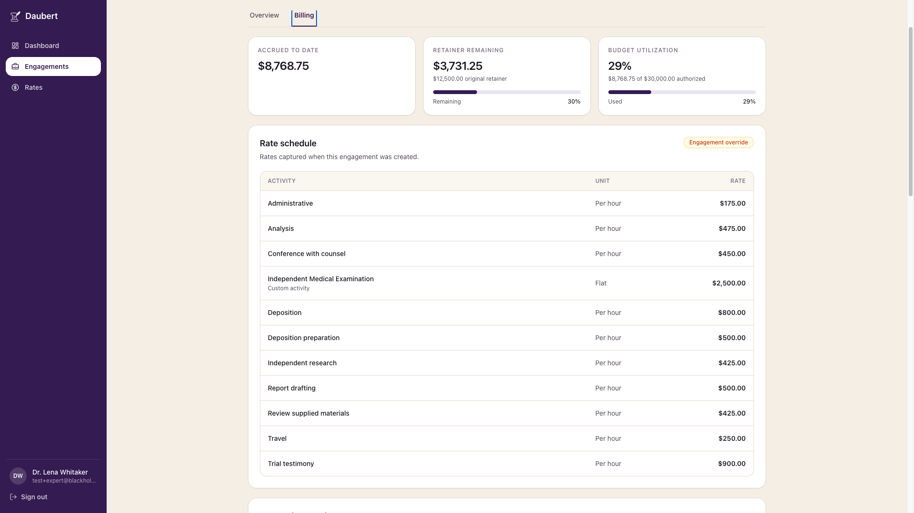
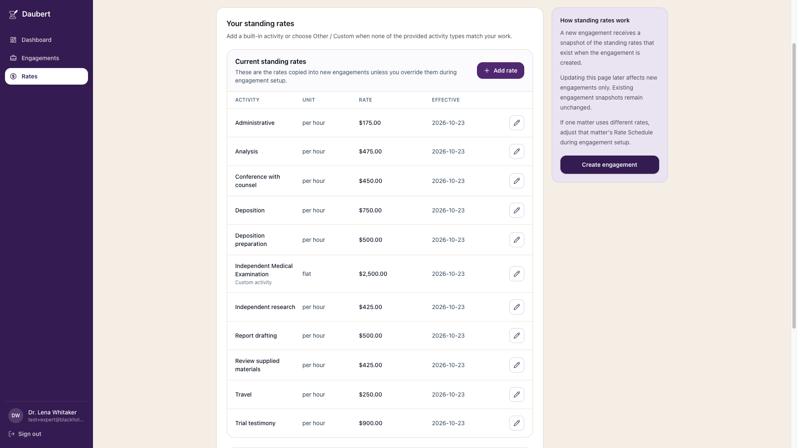
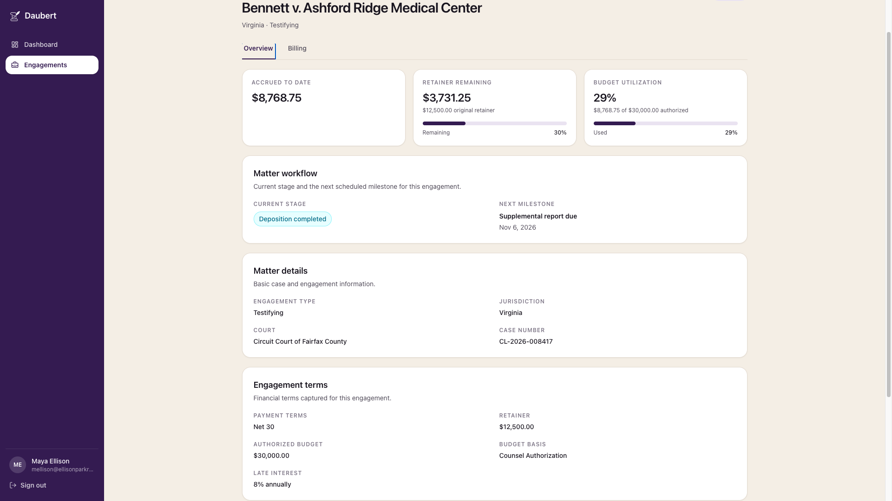
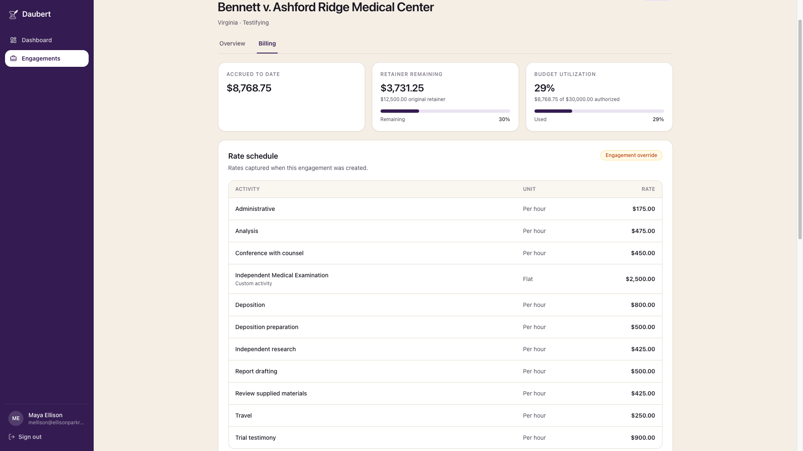
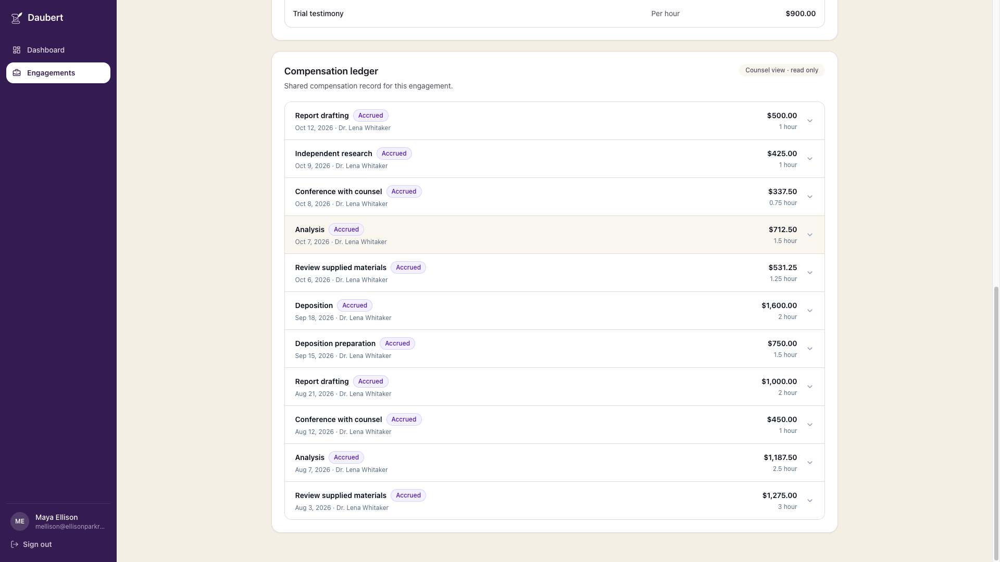

# Product Walkthrough

The screenshots in this walkthrough use synthetic demonstration data and are intended to show the product workflows associated with the engineering decisions documented elsewhere in this repository.

## 1. Expert workspace

The expert workspace provides a concise view of current engagements together with expert-side actions such as engagement creation and standing-rate management.

## 2. Engagement creation

The engagement workflow captures matter information and financial terms, including payment terms, retainer information, authorized budget information, testimony details, and the rate schedule that will be preserved for the engagement.

## 3. Engagement overview

The engagement workspace combines matter details with derived financial context.

The financial header presents values such as:

- accrued compensation;
- retainer remaining;
- authorized-budget utilization.

These values are derived from authoritative engagement and ledger state.

## 4. Billing and compensation

### Engagement rate snapshot

The billing workflow preserves the rate schedule captured for the engagement, including matter-specific overrides that differ from the expert's standing rates.

This keeps historical billing terms stable even if the expert later changes their default standing rates.

### Compensation ledger

The compensation ledger records expert-side work across manual and imported entries while applying the engagement's authoritative rate schedule.

Expert-side participants can contribute work according to their permissions, while counsel receives the shared, non-staged financial view without access to expert-side staging or publication controls.

## 5. CSV review workflow

Imported time-entry data is converted into review candidates before publication.

The workflow distinguishes rows that are ready to publish from rows containing warnings or validation errors. Source-rate mismatches can be surfaced during review while authoritative calculations continue to use the engagement snapshot.

## 6. Standing-rate management

Experts can maintain reusable activity rates, including custom activities.

Standing-rate changes affect future engagement configuration without silently rewriting the rate snapshot preserved for an existing engagement.

## 7. Counsel view

The counsel-side experience demonstrates that the same engagement data can be presented through a different permission model without changing the underlying matter.

### Shared engagement overview

Counsel can view the same engagement terms and shared financial summary available to authorized participants, including accrued compensation, retainer information, authorized-budget utilization, and matter terms.

This provides a consistent financial view across the engagement while preserving role-specific controls.

### Engagement rates

Counsel can view the rate schedule captured for the engagement, including matter-specific overrides that differ from the expert's standing rates.

The rates are visible for transparency, while rate-management controls remain on the expert side.

### Compensation ledger

Counsel can review the shared, non-staged compensation ledger for the engagement.

Expert-side staging, editing, CSV import, publication, and other mutation controls remain unavailable to counsel. These restrictions are enforced by the backend authorization model in addition to the role-aware interface.

## 8. Responsive application shell

The application shell and primary workflows are designed to remain usable across desktop and smaller viewport layouts.